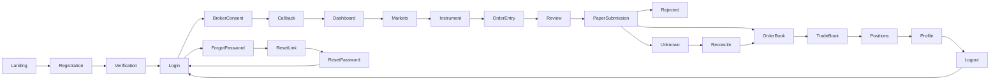
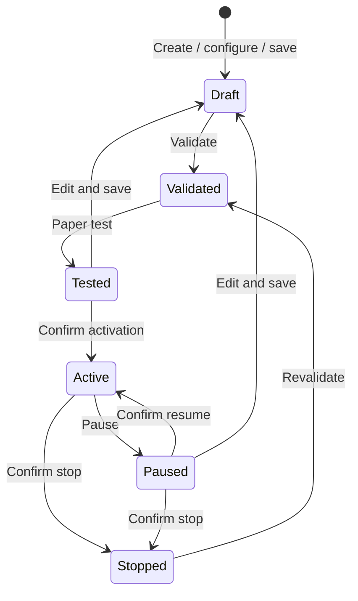

# GNK ALGO

**Intelligence Behind Every Trade.** An independent React/TypeScript/Vite/Tailwind frontend and FastAPI backend, with PostgreSQL 17, SQLAlchemy 2.0/Psycopg 3, Alembic, Redis 8, Docker Compose, Nginx and GitHub Actions.

## Server-backed deployment

Production origin: **https://www.gnkalgo.com**. Follow [deployment setup](docs/DEPLOYMENT.md) for environment variables, SMTP, TLS, migrations, administrator bootstrap and container commands. 

Docker builds use the server adapter with authenticated HttpOnly-cookie sessions and database-backed paper orders. The local demo below remains isolated and uses no backend.

## Run the standalone frontend demo

Requires Node.js 22.12+ or 24+ and npm. From this directory:

```powershell
cd frontend
npm ci
npm run dev
```

Open http://127.0.0.1:5173. Use **Explore paper workspace** on the landing page, or register with fictional information and the public sample password `PaperDemo!2026`. Existing demo login: `trader@gnk.demo` / `PaperDemo!2026`. Do not enter a real password. The verification and reset links are explicitly simulated; no email is sent.

```powershell
npm run typecheck
npm test
npx playwright install chromium
npm run test:e2e
npm run build
npm run preview
```

Playwright runs the full suite in desktop Chromium (1440×1000) and Pixel 7 mobile emulation. It starts its own Vite server. Screenshots, videos, and traces are disabled for journey tests to prevent form capture. Visual QA captures only the fictional landing/dashboard separately. See [validation results](docs/TEST-RESULTS.md).

No environment variables are required for the demo. Set VITE_API_MODE=server to use the FastAPI adapter. The root .env.example documents backend configuration; all VITE_* values are public and must contain no secrets.

## Scope and safety

- The original frontend demo is still isolated. The independent GNK backend implements authentication, authorization and persisted paper workflows plus an audited, fail-closed live-session control plane. No OpenAlgo backend, real broker connection, live feed or external order execution is included.
- Demo mode uses the typed in-memory adapter; refresh/logout clears its session and ledger. Server mode dispatches to frontend/src/api/server.ts and uses HttpOnly server cookies plus PostgreSQL persistence. Neither mode writes tokens to localStorage/sessionStorage.
- Demo passwords are public fixture inputs, compared transiently and never stored. This simulator is **not an authentication or authorization system**. Route guards only preview navigation. In server mode, the GNK API enforces sessions, CSRF, roles, account ownership and paper-order validation.
- All balances, prices, returns, positions, charts and activity are fictional. The dashboard includes clearly illustrative sample positions and performance. Books/portfolio show only actual orders submitted within the current demo session; sample positions are not imported into that ledger.
- The paper ledger supports filled, rejected and unknown outcomes. Request identifiers prevent duplicate submissions. Unknown orders do not change balance until reconciled and block new orders. Reconciliation resolves the same request rather than resubmitting it.
- All orders are paper-only and reviewed explicitly. The dashboard can record a live-session request, but cannot activate it: this deployment does not retain broker authentication or provision isolated OpenAlgo sessions per GNK user. Live mode must remain unavailable until per-user isolation, broker identity validation, risk checks, and reconciliation are verified.
- Fixture fills ignore fees, slippage, tick sizes, partial fills, liquidity, margin and exchange settlement. Sell orders can create a negative net position. Limit orders fill immediately at their entered price. Do not use these calculations for trading decisions.
- Strategy validation and paper testing exercise configuration and UI transitions only. There is no running engine, historical backtest or profitability claim.

## Screen flow





## Project guide

- [Reference audit and component mapping](docs/REFERENCE-AUDIT.md)
- [Route map, page specifications, components and design tokens](docs/UI-SPEC.md)
- [Independent GNK API boundary and production integration requirements](docs/API-BOUNDARY.md)
- [Verification results and limitations](docs/TEST-RESULTS.md)
- `frontend/src/pages/`: landing, identity, dashboard, markets, brokers, order books, strategies and settings/admin.
- `frontend/src/components/`: shared terminal shell, navigation, badges, feedback, charts and native dialogs.
- `frontend/src/api/`: typed simulator and critical state-machine tests.
- `frontend/e2e/journeys.spec.ts`: user journeys and failure recovery.

Use **Demo scenarios** in the footer to simulate timeouts, login failures, expired links, denied authorization, expired broker connections, feed loss, rejected/unknown orders, loading, empty states or expired sessions. The same panel exposes a clearly labeled demo role preview for admin screens. Browser offline events also show a recovery banner and block simulator mutations. Return the scenario to `normal` to recover (expired brokers require reconnecting; expired app sessions require signing in).

For the standalone demo, serve generated frontend/dist/ as a static SPA with history fallback. For server mode, use the Docker/Nginx deployment guide. Publishing/deployment has not been performed. No changes were made to other GNK repositories. Server and container delivery configuration is prepared but has not been deployed. The supplied logo is copied verbatim to `frontend/public/gnk-logo.png` (SHA-256 `808A77EE26E367A7A41251F010FE987E82D7467EDF7519CC0B51238E2D86BC6C`).
